  

# Awesome Operational Risk Management (ORM) 🛡️

  
  
  
  
  
  
  
  

---

## 📌 Executive Overview & SEO Context 🔍

**Operational Risk Management (ORM)** encompasses the continuous identification, assessment, mitigation, and monitoring of risks resulting from inadequate or failed internal processes, human factors, systems failures, third-party vendor disruptions, or external legal and regulatory events. 

This repository is a curated catalog of enterprise **Software-as-a-Service (SaaS)** platforms and sovereign **Open-Source Software (OSS)** frameworks engineered for risk professionals, Chief Risk Officers (CROs), GRC practitioners, and resilience engineers. Core focus disciplines include:
- 📋 **Risk Registers & Heat Maps**: Inherent vs. residual risk scoring, likelihood-impact quantification, and risk taxonomy standardization.
- 🛡️ **Risk & Control Self-Assessments (RCSA)**: Automated control design evaluation, operational effectiveness testing, and deficiency remediation.
- 📉 **Loss Event Data & Incident Management**: Tracking internal loss events, near-misses, root-cause analyses, and regulatory threshold reporting.
- 📊 **Key Risk Indicators (KRIs) & Key Control Indicators (KCIs)**: Continuous telemetry thresholds with automated alerts and executive dashboards.
- ⚖️ **Regulatory & Resilience Compliance**: Alignment with **Basel III / Basel IV (BCBS)**, **DORA (Digital Operational Resilience Act)**, **NIS2**, **ISO 31000**, **ISO 27005**, **SOX / ICFR**, and **COSO ERM**.

---

## 📑 Table of Contents

- [🌐 Sector Overview & Market Dynamics](#-sector-overview--market-dynamics)
- [🏢 Enterprise SaaS & Hosted ORM Platforms](#-enterprise-saas--hosted-orm-platforms)
- [💻 Sovereign Open-Source Risk & GRC Projects](#-sovereign-open-source-risk--grc-projects)
- [📚 Regulatory Frameworks & Standards](#-regulatory-frameworks--standards)
- [🤝 How to Contribute](#-how-to-contribute)
- [💖 Support & Sponsorship](#-support--sponsorship)
- [📈 Star History](#-star-history)
- [⚖️ Disclaimer](#️-disclaimer)

---

## 🌐 Sector Overview & Market Dynamics

The global **Operational Risk Management (ORM) software market** is estimated at **$2.15 Billion in 2026** and is projected to expand to **$4.77 Billion by 2035**, compounding at an annual growth rate (CAGR) of **9.3% to 9.6%** (with the broader Governance, Risk, and Compliance / GRC software ecosystem surpassing **$15+ Billion**). This sustained acceleration is propelled by stringent regulatory mandates (such as the EU Digital Operational Resilience Act / DORA, Basel III final reforms, and SEC cybersecurity disclosure rules) alongside compounding third-party supply chain and IT operational vulnerabilities.

Market concentration in ORM is **moderately fragmented**. While tier-1 enterprise software incumbents (notably ServiceNow, Archer, and MetricStream) hold substantial anchor footprints within heavily regulated banking, capital markets, and multinational healthcare institutions, the sector does not exhibit a winner-take-all monopoly. Dynamic mid-market GRC suites, specialized third-party risk management (TPRM) tools, and rapidly maturing self-hosted open-source platforms compete aggressively by offering modular deployments, developer-friendly REST/GraphQL and MCP APIs, and freedom from prohibitive per-seat licensing lock-in.

---

## 🏢 Enterprise SaaS & Hosted ORM Platforms

The table below outlines leading enterprise SaaS platforms for Operational Risk Management, sorted in descending order by **Company Size (Market Capitalization / Estimated Private Valuation & Annual Revenue)**.

| Platform / Vendor 🏢 | Company Size (Valuation / Revenue) 📊 | Starting Tier Pricing 💰 | Free Tier / Free Trial Limits ⏱️ | Core ORM Capabilities & Architecture Highlights ⚙️ |
| :--- | :--- | :--- | :--- | :--- |
| **[ServiceNow IRM / ORM](https://www.servicenow.com/)** | **~$150B+ Market Cap** (NYSE: NOW) • *~$13.3B Annual Revenue* | **~$125 / operator / month** (IRM Standard; ~$1,500/yr); Full ORM (IRM Pro) starts at **~$250 / operator / mo** (~$30,000/yr min contract) | **0-Day Free Trial** (No free production tier; live guided demo upon enterprise scoping). Free non-commercial Personal Developer Instance (PDI) available via Dev Portal (expires after 10 days of inactivity). | Enterprise-wide Integrated Risk Management on the Now Platform. Connects CMDB infrastructure to risk registers, loss event recording, automated control testing, and AI-driven Now Assist workflows. |
| **[Workiva](https://www.workiva.com/)** | **~$4.9B Market Cap** (NYSE: WK) • *~$885M Annual Revenue* | **~$35,000 / year** baseline entry package (approx. ~$1,200 / named user / year for core reporting & controls) | **0-Day Free Trial** (No self-serve free plan or free trial; customized live product demo and environment sandbox provided upon consultation). | Premier cloud platform for financial reporting compliance, SOX internal controls (ICFR), operational risk matrices, and unified audit trails linking data directly to SEC/regulatory filings. |
| **[Archer IRM](https://www.archerirm.com/)** | **~$2.0B+ Private Valuation** (Cinven) • *~$220M+ Annual Revenue* | **~$14,000 – $25,000 / year** modular starter package (comprehensive multi-module enterprise suites scale to **$80,000 – $200,000+ / yr**) | **0-Day Free Trial** (No open self-service free trial; qualified enterprise prospects receive a guided walkthrough and scoped 30-day proof-of-concept sandbox). | Established enterprise GRC benchmark. Features quantitative dollar-value loss exposure, end-to-end risk registers, incident tracking, third-party governance, and audit-grade historical trails. |
| **[Riskonnect](https://www.riskonnect.com/)** | **~$1.2B – $1.5B Private Valuation** (Thoma Bravo / TA Associates) • *~$140M+ Annual Revenue* | **~$38,000 – $85,000 / year** for single-module starter deployment (~$900 – $1,600 / user / yr within standard tiered user bands) | **0-Day Free Trial** (No freemium or self-service free trial; scheduled 1-on-1 walkthrough and 30-day pilot sandbox available upon qualified sales validation). | Integrated risk management built on Salesforce infrastructure. Integrates ERM, operational risk, claims administration, business continuity, and healthcare incident reporting. |
| **[MetricStream](https://www.metricstream.com/)** | **~$480M – $600M Private Valuation** (Clearlake Capital) • *~$137M Annual Revenue* | **~$75,000 / year** entry baseline package for small enterprise deployments (named admin/operator seats range from **$200 to $2,500 / user / app / yr**) | **0-Day Free Trial** (No public free tier or open trial; 14-day guided proof-of-concept sandbox offered to vetted enterprise RFP candidates). | Category leader across enterprise GRC. Powered by the MetricStream CyberGRC and EnterpriseGRC engines with AI-assisted control evidence gathering, risk sensing, and regulatory change tracking. |
| **[SAI360](https://www.sai360.com/)** | **~$300M – $500M Private Valuation** (STG / Symphony Technology Group) • *~$75M – $100M Annual Revenue* | **~$15,000 – $25,000 / year** modular entry tier (approx. ~$500 – $1,000 / operator / yr for mid-market risk & compliance packages) | **0-Day Free Trial** (No public free plan; custom 14-day guided evaluation sandbox configured after discovery consultation with technical specialists). | Unified GRC platform merging operational risk assessments, internal audit management, ethics training, regulatory change intelligence, and automated control testing workflows. |
| **[Resolver](https://www.resolver.com/)** | **~$250M – $400M Private Valuation** (Kroll / Stone Point Capital) • *~$50M – $80M Annual Revenue* | **~$10,000 – $12,000 / year** starting tier (approx. ~$1,000 / month base subscription for core risk registers and incident management) | **0-Day Free Trial** (No free plan; personalized guided demo and 14-day scoped test sandbox provided for qualified enterprise risk and security teams). | Risk intelligence engine specializing in operational risk registers, loss and incident triage, corporate security management, and regulatory compliance mapping across enterprise operations. |
| **[LogicGate Risk Cloud](https://www.logicgate.ai/)** | **~$100M – $150M Private Valuation** ($166M Total Funding Raised) • *~$49M Annual Revenue* | **~$13,000 – $14,000 / year** starter tier for single application workflow (median enterprise deployment spend: ~$52,000 / yr; read/task respondents free) | **0-Day Free Trial** (No self-serve free trial; tailored interactive sandbox demo with pre-built risk apps and MCP server integration access upon sales consultation). | Flexible no-code graph-based GRC platform. Features AI GRC agents, automated control testing with rationale documentation, bulk record linking, and Model Context Protocol (MCP) server support. |
| **[Protecht ERM](https://www.protechtgroup.com/)** | **~$100M – $150M Private Valuation** (Arrowroot Capital / PSG Equity) • *~$25M – $35M Annual Revenue* | **~$10,000 – $15,000 / year** baseline subscription (approx. ~$75 / user / month for core risk management module; scales with add-on modules) | **14-Day Guided Free Trial** (Self-contained trial sandbox pre-configured with risk registers, control matrices, and heat maps upon request; no credit card required). | Specialized enterprise risk management software featuring dynamic risk registers, appetite statements, KRI threshold alerts, and operational resilience mapping for financial institutions. |
| **[Camms.Risk](https://www.cammsgroup.com/)** | **~$80M – $120M Private Valuation** (Acquired by Riskonnect in 2024) • *~$22M – $30M Annual Revenue* | **~$8,500 – $12,000 / year** entry-level core risk management tier (approx. ~$34 – $80 / user / month based on functional role and module access) | **0-Day Free Trial** (No open self-serve trial; custom live guided walkthrough and tailored pilot environment arranged via technical account representatives). | Integrated risk, strategy, and compliance management platform tailored for public sector, healthcare, and regulated commercial enterprises requiring clear executive heat maps. |

---

## 💻 Sovereign Open-Source Risk & GRC Projects

Open-source operational risk management solutions allow organizations to build sovereign, auditable risk infrastructure without recurring per-seat licensing penalties or proprietary data lock-in. 

The projects below are sorted in descending order by **GitHub Star Count** ⭐.

### 1. [intuitem/ciso-assistant-community](https://github.com/intuitem/ciso-assistant-community) 
- **License**: AGPL-3.0 | **Stack**: Python (Django), Vue.js, PostgreSQL, Docker
- **Focus**: Enterprise GRC, Risk Register, Framework Cross-Mapping & Automated Evidence
- **Overview**: An all-in-one open-source GRC platform covering operational risk management, Business Impact Analysis (BIA), Third-Party Risk Management (TPRM), privacy (GDPR/DPIA), and internal audits. Ships with pre-loaded crosswalks for 200+ global frameworks (ISO 27001, NIST CSF, DORA, NIS2, SOC 2, PCI DSS) and integrates with n8n, Kafka, and Model Context Protocol (MCP) tools for AI agents.

### 2. [strongdm/comply](https://github.com/strongdm/comply) 
- **License**: Apache-2.0 | **Stack**: Go, Markdown
- **Focus**: SOC 2 Compliance Automation, Policy-as-Code & Operational Control Audits
- **Overview**: A developer-centric compliance and operational control orchestration CLI. Enables engineering teams to maintain compliance policies, procedure playbooks, and control verification checklists directly within Git version control. Automates policy ticketing and audit evidence gathering for SOC 2 and ISO 27001.

### 3. [getprobo/probo](https://github.com/getprobo/probo) 
- **License**: ISC | **Stack**: Go, TypeScript, GraphQL, Docker
- **Focus**: Full-Lifecycle GRC, Risk Scoring & AI MCP Automation
- **Overview**: A modern, self-hostable GRC suite with a comprehensive risk register supporting inherent and residual risk scoring, risk treatment decisions (Mitigate, Accept, Avoid, Transfer), control maturity tracking, vendor risk, and access reviews. Features 270+ native Model Context Protocol (MCP) tools for autonomous AI agent compliance tasks and a dedicated `prb` CLI.

### 4. [bmarsh9/gapps](https://github.com/bmarsh9/gapps) 
- **License**: GPL-3.0 | **Stack**: PHP, MySQL, Bootstrap
- **Focus**: Multi-Framework Security Compliance & Control Assessment Tracker
- **Overview**: Web-based compliance and risk management management portal supporting SOC 2, CMMC, ASVS, ISO 27001, HIPAA, NIST CSF, and NIST 800-53. Facilitates internal control reviews, maturity ratings, gap analyses, and compliance roadmap generation for growing security organizations.

### 5. [sourcentis/deming](https://github.com/sourcentis/deming) 
- **License**: AGPL-3.0 | **Stack**: Python, Django, PostgreSQL
- **Focus**: Information Security Management System (ISMS) & Risk Assessment
- **Overview**: A dedicated management tool for operational and information security management systems following the Deming PDCA (Plan-Do-Check-Act) cycle. Provides asset identification, risk assessment matrices, Statement of Applicability (SoA) tracking, and continuous control oversight.

### 6. [theopenlane/core](https://github.com/theopenlane/core) 
- **License**: Apache-2.0 | **Stack**: Go, GraphQL, Ent, PostgreSQL
- **Focus**: Modern Cloud-Native Compliance & Risk Automation Engine
- **Overview**: An open-source, developer-friendly compliance automation backend designed for modern SaaS organizations. Automates evidence collection, control verification, and audit readiness across SOC 2, ISO 27001, GDPR, and NIST 800-53 with fine-grained role-based access control and immutable audit trails.

### 7. [GovReady/govready-q](https://github.com/GovReady/govready-q) 
- **License**: GNU AGPL-3.0 | **Stack**: Python (Django), Vue.js, PostgreSQL
- **Focus**: Self-Service GRC & Automated System Security Plans (SSP)
- **Overview**: Self-service compliance toolkit that turns complex regulatory standards (NIST SP 800-53, FedRAMP, FISMA) into interactive questionnaires. Automatically generates audit-ready System Security Plans (SSPs) and risk assessments for DevSecOps and cloud deployments.

### 8. [grcengineering/gigachad-grc](https://github.com/grcengineering/gigachad-grc) 
- **License**: MIT | **Stack**: TypeScript, Next.js, Node.js, Prisma, PostgreSQL
- **Focus**: Containerized GRC Platform, Risk Registers & Vendor Assessments
- **Overview**: Modern, lightweight GRC portal engineered for fast-moving engineering and security organizations. Features streamlined risk registers, third-party vendor assessments, control mappings for SOC 2 and ISO 27001, and role-based audit dashboards with minimal deployment overhead.

### 9. [LeeMangold/OpenGRC](https://github.com/LeeMangold/OpenGRC) 
- **License**: GPL-3.0 | **Stack**: PHP, MySQL, Apache
- **Focus**: Self-Hosted Operational Risk, Controls & Incident Management
- **Overview**: Purpose-built self-hosted GRC platform designed for small-to-midsize enterprises. Features risk documentation, internal control libraries, audit schedule tracking, vendor risk scorecards, and incident response logging tailored for ISO 27001, NIST CSF, and HIPAA.

### 10. [monarc-project/MonarcAppFO](https://github.com/monarc-project/MonarcAppFO) 
- **License**: AGPL-3.0 | **Stack**: PHP, AngularJS, Python, MariaDB, Docker
- **Focus**: ISO/IEC 27005 Context-Based Operational & Information Risk Analysis
- **Overview**: Risk assessment methodology and software developed by CASES Luxembourg. Enables structured assessment of operational and cyber risks through reusable risk models. Connects to the MONARC Objects Sharing Platform (MOSP) to share threat catalogs, vulnerabilities, and control templates across industry peers.

### 11. [simplerisk/code](https://github.com/simplerisk/code) 
- **License**: AGPL-3.0 | **Stack**: PHP, MySQL, Docker
- **Focus**: Classic Operational & IT Risk Management Platform
- **Overview**: One of the most widely deployed open-source enterprise risk management applications. Provides dynamic risk registers, scoring via classic (Likelihood x Impact) and CVSS methodologies, risk mitigation planning, control testing, and compliance framework tracking with containerized Docker deployment.

### 12. [frousselet/cairn](https://github.com/frousselet/cairn) 
- **License**: AGPL-3.0 | **Stack**: TypeScript, NestJS, React, PostgreSQL, Docker
- **Focus**: EBIOS RM & ISO 27005 Operational Risk Analysis with MCP Support
- **Overview**: Modern self-hosted GRC engine implementing French ANSSI EBIOS RM and ISO 27005 standards. Features multi-tier risk registers, asset dependency maps with CIA impact scoring, statutory incident notification timers, public trust centers, and built-in Model Context Protocol (MCP) server endpoints for AI integration.

### 13. [cary-williams/risk-shield](https://github.com/cary-williams/risk-shield) 
- **License**: MIT | **Stack**: TypeScript, React, Vite, Tailwind CSS
- **Focus**: Interactive Web-Based Risk Register & Heat Map Generator
- **Overview**: Lightweight, client-side web application for generating structured operational risk registers. Calculates inherent vs. residual risk scores, accounts for control effectiveness multipliers, and renders interactive 5x5 color-coded risk heat maps deployable directly via Vercel or GitHub Pages.

### 14. [prashant-fintech/risklab](https://github.com/prashant-fintech/risklab) 
- **License**: MIT | **Stack**: Python 3.12+, FastAPI, Streamlit
- **Focus**: Quantitative Operational Risk & Loss Distribution Approach (LDA)
- **Overview**: Quantitative financial and operational risk platform. Implements regulatory loss modeling via the Loss Distribution Approach (LDA), fitting severity (Lognormal, Weibull) and frequency (Poisson) distributions. Includes Value-at-Risk (VaR), Expected Shortfall (ES), and operational stress testing.

---

## 📚 Regulatory Frameworks & Standards

Operational Risk Management architectures are governed by globally recognized frameworks and legal mandates:

| Standard / Mandate 🏛️ | Governing Body 🌐 | Primary ORM Relevance & Impact 🎯 |
| :--- | :--- | :--- |
| **Basel III / Basel IV** | Basel Committee on Banking Supervision (BCBS) | Mandates Standardised Measurement Approach (SMA) for operational risk capital, operational loss event databases, and risk governance. |
| **DORA (Digital Operational Resilience Act)** | European Union (EU) | Establishes uniform operational resilience requirements for EU financial entities regarding ICT risk, incident reporting, and third-party risk. |
| **ISO 31000:2018** | International Organization for Standardization | Global foundational standard for enterprise risk management, risk assessment principles, and governance guidelines. |
| **ISO/IEC 27005:2022** | ISO / IEC | International guidance on information security, cybersecurity, and operational risk assessment methodologies. |
| **COSO Enterprise Risk Management** | Committee of Sponsoring Organizations | Industry benchmark framework integrating risk strategy, organizational culture, and control execution. |
| **SOX Section 404 (ICFR)** | US Securities and Exchange Commission | Requires management and independent auditors to test and validate internal controls over financial reporting to avoid operational failures. |

---

## 🤝 How to Contribute

Contributions from risk officers, compliance analysts, developers, and researchers are warmly welcomed! 🌟

1. **Fork the Repository** on GitHub: `https://github.com/ishandutta2007/Awesome-Operational-Risk-Management-ORM`.
2. **Create a Feature Branch**: `git checkout -b feature/add-new-orm-tool`.
3. **Add Your Entry**: Edit `README.md` following the established tabular (SaaS) or star-badged list (OSS) format.
   - Include factual descriptions, verifiable licensing, exact starting pricing, and realistic trial limits.
4. **Sort Appropriately**:
   - SaaS entries must be sorted descending by company size / valuation.
   - OSS entries must include the social star badge (`style=social&color=white`) linking to `/stargazers` and be sorted descending by stars.
5. **Commit and Submit PR**: Submit a descriptive Pull Request detailing your changes.

---

## 💖 Support & Sponsorship

If you find this curated collection of Operational Risk Management resources helpful for your organization, audits, or engineering projects, please consider supporting the project:

- ⭐ **Star this repository** to improve visibility for the risk and GRC community.
- 🍴 **Fork and share** with fellow risk managers, compliance officers, and engineers.
- ☕ **Sponsor the Maintainer**: Support ongoing curation, research, and open-source tooling by sponsoring via GitHub Sponsors:  
  👉 **[Sponsor @ishandutta2007 on GitHub Sponsors](https://github.com/sponsors/ishandutta2007)** 💖

Thank you for championing transparent, audit-ready, and resilient operational risk management! 🛡️

---

## 📈 Star History

---

## ⚖️ Disclaimer

- This curated list is maintained for educational, research, and technical evaluation purposes only and does not constitute formal legal, regulatory, or investment advice.
- Operational risk tools deployed in regulated environments (banking, insurance, defense, healthcare) must undergo independent validation in compliance with jurisdictional regulations (e.g., BCBS 239, DORA, Fed SR 11-7, Solvency II).
- All trademarks, service marks, logos, and company names are the property of their respective owners. Mention does not imply endorsement.
- Verify open-source software license terms prior to commercial deployment.
